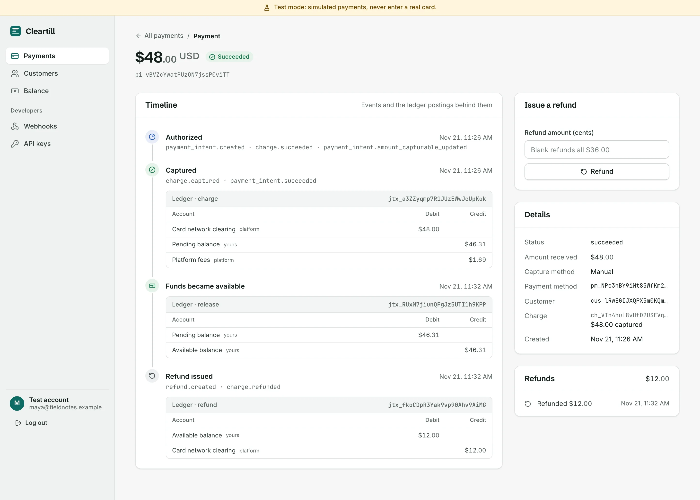
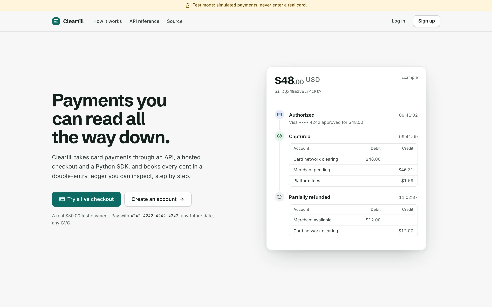
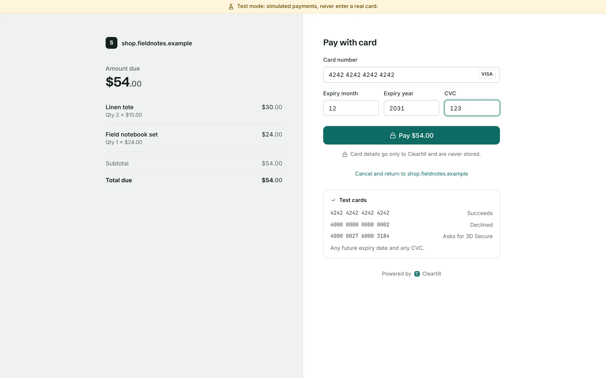
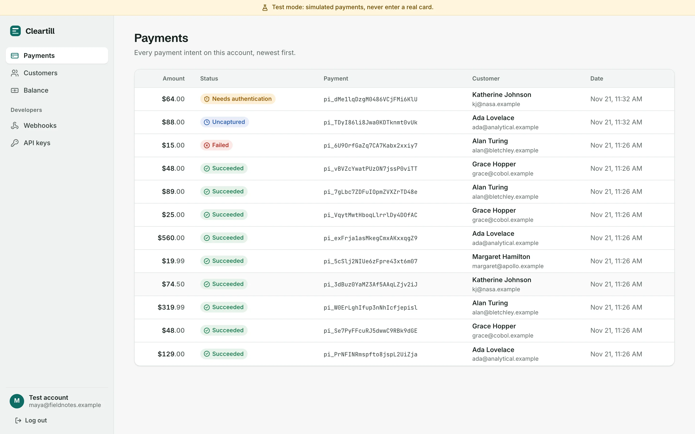
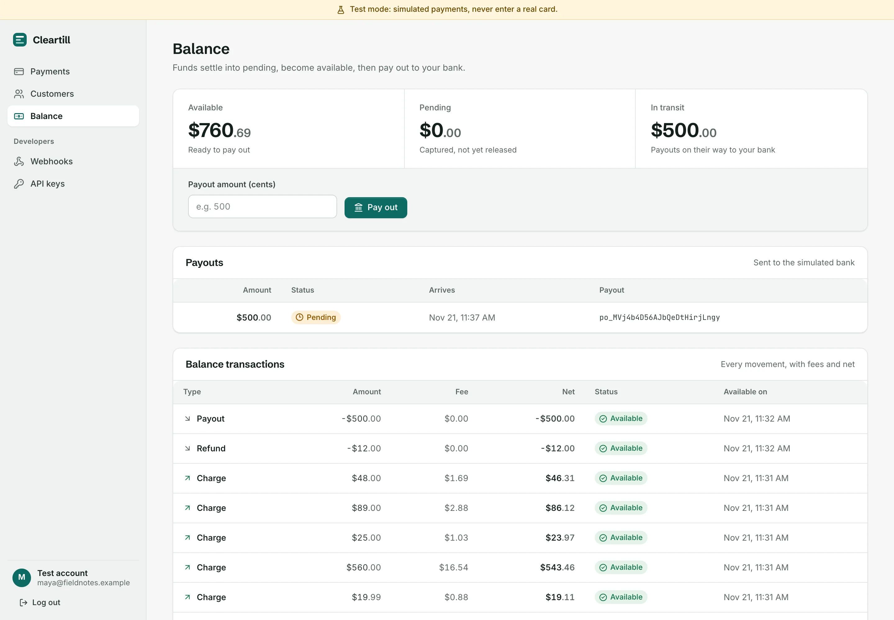
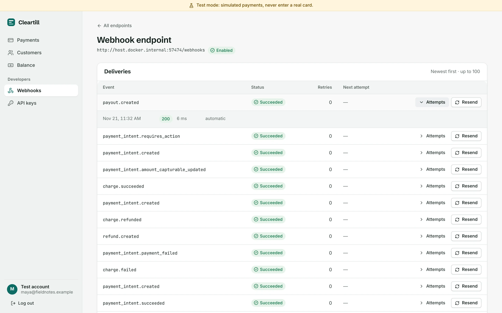
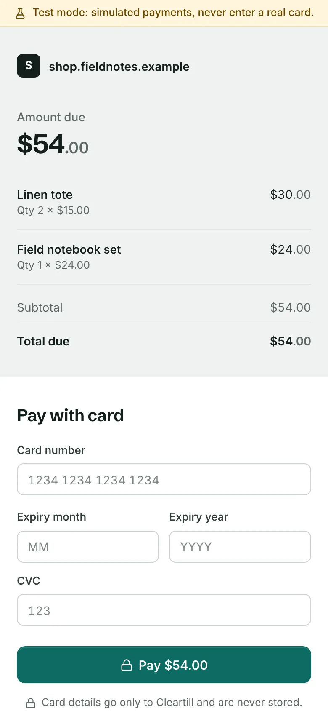
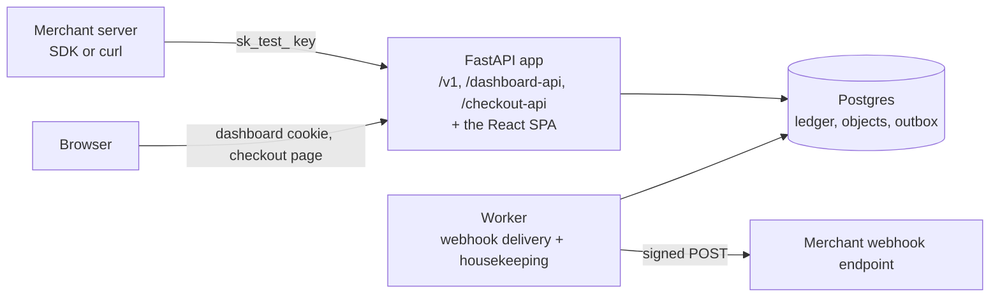

# Cleartill

**A payments platform in the style of Stripe, built end to end:** a card-payments API, hosted
checkout, a merchant dashboard, a Python SDK and signed webhooks, with every cent booked in a
double-entry ledger that the database itself keeps balanced.

**Live demo: [cleartill.onrender.com](https://cleartill.onrender.com).** Click "Try a live
checkout" and pay with `4242 4242 4242 4242`, or create an account to explore the dashboard.
<sub>It runs on a free plan that sleeps when idle, so the first visit can take up to a minute.</sub>



<sub>A payment's full life: authorized, captured, funds released, partially refunded. Each step
shows the balanced debits and credits it posted to the ledger.</sub>

> Cleartill runs in test mode against a simulated card network. No real money moves. It is an
> independent learning project, not affiliated with Stripe.

## At a glance

| | |
|---|---|
| **What it is** | A working payments product: API, dashboard, hosted checkout, SDK and webhooks |
| **Backend** | Python 3.13, FastAPI, SQLAlchemy 2, PostgreSQL 16, Alembic |
| **Frontend** | React and Vite, with a custom design system (no UI kit) |
| **Quality** | 1,076 API tests including 29 browser tests (Playwright), and 147 SDK tests |
| **Delivery** | Built in 23 milestones, each test-first, code-reviewed and merged through CI (27 PRs) |
| **CI** | Six jobs: API tests, browser tests, SDK on Python 3.11 and 3.13, OpenAPI client generation, and an end-to-end smoke test against the Docker stack |

## What it demonstrates

**Money that can't go wrong silently.** Every capture, refund, release and payout is a balanced
double-entry journal transaction. Postgres triggers reject unbalanced or edited entries, and a
reconciliation job checks the invariants at startup.
→ [`ledger.py`](api/app/ledger.py), [`ledger_check.py`](api/app/ledger_check.py),
[migration with the triggers](api/alembic/versions/0005_ledger.py)

**Correct under concurrency.** Money paths take row locks in one global order. That covers two
refunds racing, a payout racing a refund, and a double-clicked "Pay". Concurrency tests run
real parallel requests against Postgres and assert exactly one winner.
→ [`payouts.py`](api/app/payouts.py),
[`test_payouts_concurrency.py`](api/tests/test_payouts_concurrency.py),
[`test_checkout_concurrency.py`](api/tests/test_checkout_concurrency.py)

**Safe retries.** Every write runs through one executor that implements `Idempotency-Key`
semantics. The SDK reuses one key across retries, and the dashboard keeps it across a lost
response, so a timeout can never charge or refund twice.
→ [`executor.py`](api/app/executor.py), [`sdk/cleartill`](sdk/cleartill)

**Reliable webhooks.** An outbox table and a worker deliver signed webhooks with fenced claims.
Failures retry with backoff for 72 hours. An SSRF guard pins each send to vetted IP addresses,
and every attempt lands in a delivery log you can resend from.
→ [`delivery.py`](api/app/delivery.py), [`urls.py`](api/app/urls.py),
[`webhooks.py`](api/app/webhooks.py)

**Security as a feature.**
- API keys and sessions are stored hashed; passwords use scrypt.
- The dashboard is protected against CSRF, and login is rate-limited.
- Every page runs under a strict Content Security Policy.
- Card numbers exist only in memory and are never stored, logged or returned.

→ [`cards.py`](api/app/cards.py), [`auth.py`](api/app/auth.py)

## Screenshots

| | |
|---|---|
|  |  |
| **Landing page.** "Try a live checkout" pays a real $30.00 test payment, no account needed. | **Hosted checkout.** Card numbers go only to Cleartill, never to the merchant's server. |
|  |  |
| **Payments.** Every payment with its status and customer. | **Balance.** Funds move from pending to available, then pay out to a simulated bank. |
|  |  |
| **Webhooks.** Signed deliveries, each attempt logged, with one-click resend. | **Mobile.** Every screen adapts down to phone widths. |

## Try it

You need Docker and [uv](https://docs.astral.sh/uv/).

```sh
docker compose up -d --build --wait
uv run scripts/smoke.py http://localhost:8000
```

The smoke script signs up a merchant and walks every money path: a payment, a partial capture and
refund, a decline, hosted checkout with and without 3D Secure, and signed webhooks delivered back
to your machine. Then open <http://localhost:8000> to try the checkout yourself, or
<http://localhost:8000/dashboard/signup> to explore the dashboard.

## Deploy (free: Render + Neon)

[`render.yaml`](render.yaml) deploys the whole app as one free Render web service:

1. Create a free [Neon](https://neon.com) Postgres project and copy its **direct** connection
   string (pooling off, so the host has no `-pooler`).
2. In [Render](https://render.com), choose **New → Blueprint**, pick this repository, and paste
   the Neon string as `DATABASE_URL`. Render generates `SECRET_KEY` itself.

Migrations run on every start, the worker runs as a thread inside the web process (Render has
no free background workers), and the public URL comes from Render's `RENDER_EXTERNAL_URL`.
On the free plan the service sleeps after 15 idle minutes, so the first request after that takes
up to a minute.

## Architecture



- **API** (`api/`) is form-encoded and Stripe-shaped. It covers payment intents, charges,
  refunds, customers, checkout sessions, payouts, balance, events and webhook endpoints.
- **Worker** (`python -m app.worker`) delivers webhooks. Every minute it also runs housekeeping:
  - releases funds that have reached their availability date;
  - expires uncaptured authorizations after 7 days, and checkout sessions after 24 hours;
  - settles payouts;
  - purges old idempotency keys and sessions.
- **Web** (`web/`) is one React app for the landing page, the dashboard and hosted checkout,
  served by the API under a strict CSP.
- **SDK** (`sdk/`) is the `cleartill` Python package: typed errors, automatic idempotency keys,
  retries with backoff, and webhook signature verification.

### What is real and what is simulated

| Real | Simulated |
|---|---|
| API keys, sessions, CSRF protection, rate-limited login | The card network: outcomes come from the test card number |
| The PaymentIntent state machine, captures, refunds, payouts | 3D Secure: a confirmation page with approve and fail |
| The double-entry ledger, fees, pending → available → paid out | Fees: a flat 2.9% + 30¢ |
| Idempotency keys, row locking, concurrency-safe money paths | The bank that receives payouts |
| Signed webhooks with retries, an SSRF guard and a delivery log | |

### Test cards

| Card number | Payment method id | Result |
|---|---|---|
| 4242 4242 4242 4242 | `pm_card_visa` | Succeeds |
| 4000 0000 0000 0002 | `pm_card_visa_chargeDeclined` | Declined (`generic_decline`) |
| 4000 0000 0000 9995 | `pm_card_visa_chargeDeclinedInsufficientFunds` | Declined (`insufficient_funds`) |
| 4000 0027 6000 3184 | `pm_card_authenticationRequired` | Asks for 3D Secure |

Use any future expiry date and any CVC.

## Using the SDK

```python
import cleartill

client = cleartill.Client("sk_test_...", base_url="http://localhost:8000")
pi = client.payment_intents.create(
    amount=2000, currency="usd", payment_method="pm_card_visa", confirm=True
)
client.refunds.create(payment_intent=pi["id"], amount=500)
for customer in client.customers.list_all(limit=100):
    print(customer["email"])
```

Use it from this repo with `uv run --with ./sdk ...`. A release workflow
([`publish-sdk.yml`](.github/workflows/publish-sdk.yml)) publishes it to TestPyPI through
trusted publishing when an `sdk-v*` tag is pushed.

## Development

```sh
cd api && uv run pytest -q          # needs Docker (Postgres via testcontainers)
cd api && uv run ruff check . && uv run ruff format --check .
cd web && npm ci && npm run build   # the API then serves the SPA
cd api && uv run playwright install chromium && uv run pytest -q tests/e2e
cd sdk && uv run pytest -q
```

`cd web && npm run dev` runs the frontend with hot reload, proxying API calls to
`localhost:8000`. [`DESIGN.md`](DESIGN.md) documents the design system.

## Layout

```
api/       FastAPI app, migrations, worker, tests (unit, integration, concurrency, Playwright)
web/       React app: landing page, dashboard and hosted checkout
sdk/       cleartill Python SDK
scripts/   smoke.py: the end-to-end check above
docs/      screenshots
```
