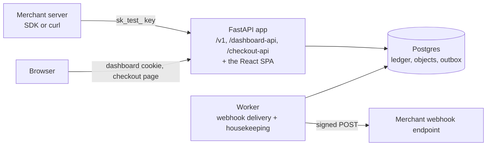

# Cleartill

A Stripe-style payments API, built as a learning project. Merchants take card payments
through an API, a hosted checkout page and a Python SDK, and every cent moves through a
double-entry ledger.

> **Test mode only.** Cleartill simulates a card network. No card is ever charged, no money
> moves, and real card numbers must never be entered. Cleartill is an independent learning
> project, not affiliated with or endorsed by Stripe.

## Quickstart

Needs Docker and [uv](https://docs.astral.sh/uv/).

```sh
docker compose up -d --build --wait
uv run scripts/smoke.py http://localhost:8000
```

`scripts/smoke.py` signs up a merchant and walks every money path:

- a payment;
- a hold that is partly captured and then partly refunded;
- a decline;
- hosted checkout, with and without 3D Secure;
- signed webhooks delivered back to your machine.

Read the script as a tour of the API.

Then open <http://localhost:8000/dashboard/signup> to create an account and look around the dashboard. It has:

- **Payments:** capture and refund.
- **Customers.**
- **Balance.**
- **Webhooks:** delivery log and resend.
- **API keys.**

In the demo stack, captured funds move from pending to available after 5 minutes
(`AVAILABILITY_DELAY_SECONDS=300`; the default is 2 days).

## Using the API

```python
import cleartill

client = cleartill.Client("sk_test_...", base_url="http://localhost:8000")
pi = client.payment_intents.create(
    amount=2000, currency="usd", payment_method="pm_card_visa", confirm=True
)
client.refunds.create(payment_intent=pi["id"], amount=500)
for customer in client.customers.list_all(limit=100):
    print(customer["email"])
```

Or with curl. Request bodies are form-encoded, as on Stripe:

```sh
curl http://localhost:8000/v1/payment_intents -u "sk_test_...:" \
  -d amount=2000 -d currency=usd -d payment_method=pm_card_visa -d confirm=true
```

Every POST accepts an `Idempotency-Key` header. The SDK sends one automatically and reuses it
when it retries. The OpenAPI spec is at `/openapi.json`, and you can browse it at `/docs`.

### Test cards

| Card number | Payment method id | Result |
|---|---|---|
| 4242 4242 4242 4242 | `pm_card_visa` | Succeeds |
| 4000 0000 0000 0002 | `pm_card_visa_chargeDeclined` | Declined (`generic_decline`) |
| 4000 0000 0000 9995 | `pm_card_visa_chargeDeclinedInsufficientFunds` | Declined (`insufficient_funds`) |
| 4000 0000 0000 0069 | | `expired_card` |
| 4000 0000 0000 0127 | | `incorrect_cvc` |
| 4000 0000 0000 0119 | | `processing_error` |
| 4000 0027 6000 3184 | `pm_card_authenticationRequired` | Asks for 3D Secure |

Use any future expiry date and any CVC. Card numbers can only be sent with a publishable key
or on the hosted checkout page. The `pm_card_*` ids work with a secret key.

### What is real and what is simulated

| Real | Simulated |
|---|---|
| API keys (hashed), dashboard sessions, CSRF protection, rate-limited login | The card network: outcomes come from the test card number |
| The PaymentIntent state machine, captures, partial captures, refunds | 3D Secure: a page with "Complete" and "Fail" buttons |
| A double-entry ledger with invariants enforced by the database, fees, pending → available | Fees: a flat 2.9% + 30¢ |
| Idempotency keys, row locking, concurrency-safe money paths | Payouts (not built) |
| Webhooks: signed, retried with backoff for 72 hours, SSRF-guarded, with a delivery log | |
| Hosted checkout under a strict CSP; card numbers are never stored or logged | |

## Architecture



- **`api/`:** FastAPI, SQLAlchemy 2 and Alembic on Postgres.
  - Every write goes through one executor that owns the transaction and idempotency.
  - The ledger module is the only writer of journal entries, and Postgres triggers reject
    entries that are unbalanced or modified.
- **Worker** (`python -m app.worker`) has two jobs:
  - It delivers webhooks from an outbox table: claim a delivery, send it with no transaction
    open, then do a fenced finish.
  - Every minute it runs housekeeping: release funds that are due, expire 7-day authorizations
    and 24-hour checkout sessions, and purge old idempotency keys and sessions.
- **`web/`:** a React SPA (Vite) for the dashboard and hosted checkout, served by the API.
- **`sdk/`:** the `cleartill` Python package.

## The SDK

```sh
pip install -i https://test.pypi.org/simple/ --extra-index-url https://pypi.org/simple/ cleartill
```

The `--extra-index-url` lets its dependencies install from PyPI. From this repo you can also
use `uv run --with ./sdk ...`.

To verify a webhook, call
`cleartill.Webhook.construct_event(raw_body, signature_header, "whsec_...")`. Deliveries are
at least once, so deduplicate on `event["id"]`.

## Development

```sh
cd api && uv run pytest -q          # needs Docker (Postgres via testcontainers)
cd api && uv run ruff check . && uv run ruff format --check .
cd web && npm ci && npm run build   # the API then serves the SPA
cd api && uv run playwright install chromium && uv run pytest -q tests/e2e
cd sdk && uv run pytest -q
```

`cd web && npm run dev` runs the SPA with hot reload and proxies API calls to `localhost:8000`.

## Layout

```
api/       FastAPI app, migrations, tests (unit, integration, Playwright e2e)
web/       React SPA: dashboard and hosted checkout
sdk/       cleartill Python SDK
scripts/   smoke.py: the end-to-end check above
```
